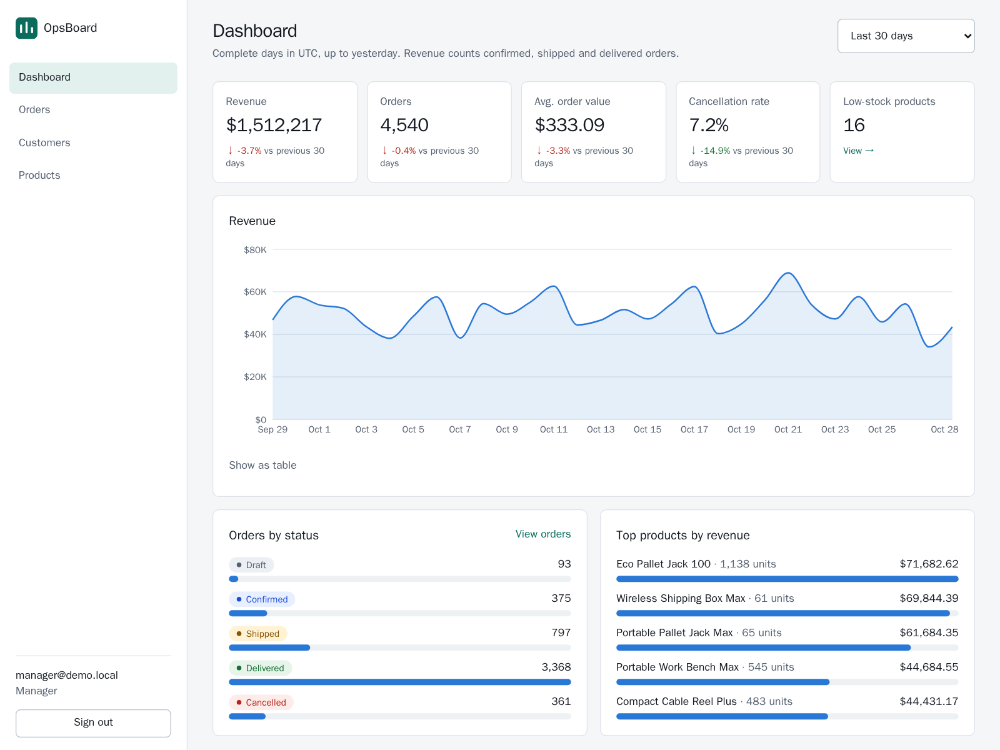
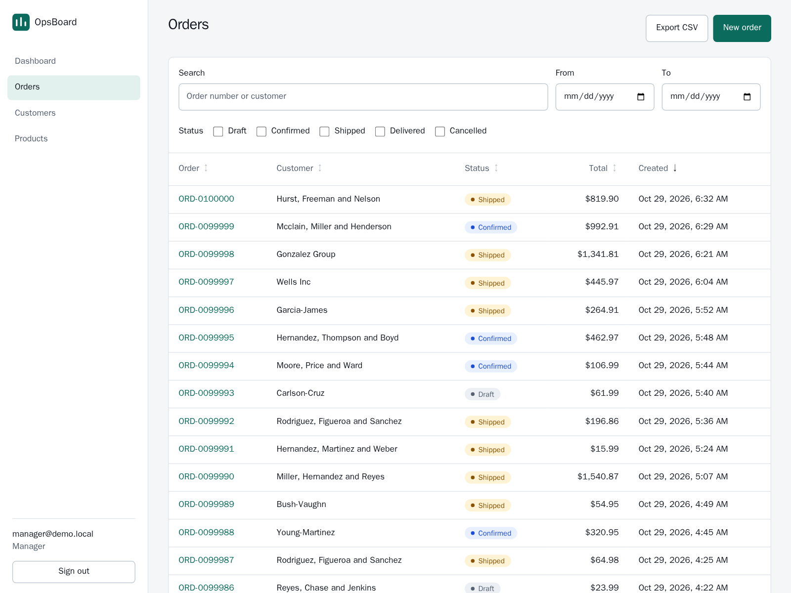
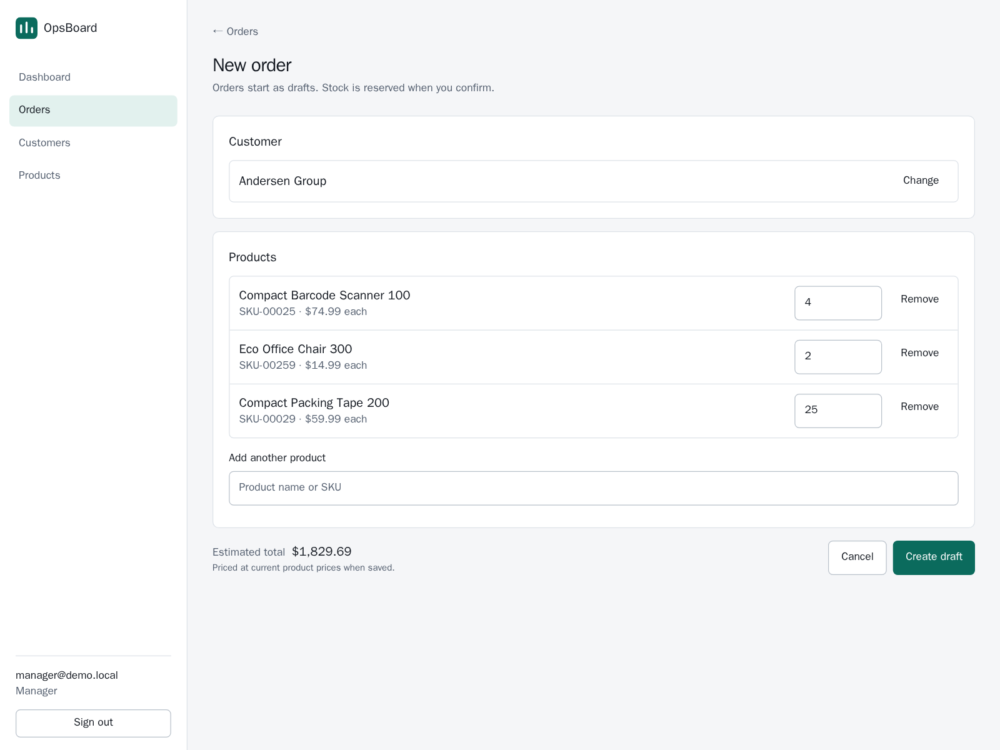
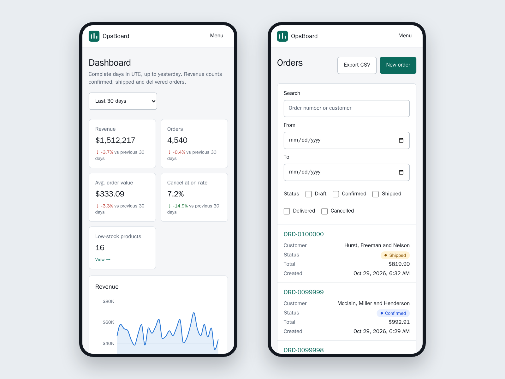

# OpsBoard

[](https://github.com/p-centauri/opsboard/actions/workflows/ci.yml)

An operations dashboard for orders, inventory and analytics: the kind of internal tool most
businesses run on. It's built to production standards and seeded with 100k realistic orders,
so performance is measured on real data volume, not a toy dataset.

> **Status:** built and tested. The deploy kit is ready, and the live demo goes up next.
> See [docs/PROGRESS.md](docs/PROGRESS.md).



| Orders | Draft editor | On a phone |
|---|---|---|
|  |  |  |

## Stack
**Web:** Next.js 16 (App Router) · React 19 · TypeScript · Tailwind CSS 4 · TanStack Query ·
React Hook Form + Zod · Recharts
**API:** FastAPI · SQLAlchemy 2 · PostgreSQL 17 · Alembic
**Ops:** Docker Compose · Caddy · GitHub Actions · Vitest · Playwright + axe

## Quick start
Requires Docker. macOS/Linux use `make`; Windows uses `./make.ps1` with the same task names.

```bash
make setup     # create .env, build images, install web deps
make seed      # apply migrations, load 100k demo orders (~10 s)
make dev       # everything with hot reload → http://localhost:3000 (API docs: :8000/docs)
make test      # API tests on real Postgres + web component tests
make e2e       # browser + accessibility tests on the production build
make lint      # ruff + mypy strict, eslint + tsc
```

| Task | What it does |
|---|---|
| `setup` | Create `.env`, build images |
| `dev` / `run` | Start with reload (dev image) / in background (prod image) |
| `stop`, `logs` | Stop containers / follow logs |
| `migrate` | Apply Alembic migrations |
| `seed` / `reseed` | Load demo data / replace all data with fresh demo data |
| `test`, `e2e`, `lint`, `format` | Unit/integration tests / browser tests / lint + type check / auto-format |
| `gen-api` | Regenerate the web app's API types from the running API |
| `screenshots` | Portfolio screenshots of the prod stack → `docs/screenshots/` (after `make run`) |

**Deploying:** one VPS, the same Compose stack, automatic HTTPS. Step by step in
[docs/DEPLOY.md](docs/DEPLOY.md).
| `clean` | Stop and **delete the database volume** |

Demo users: `viewer@demo.local` and `manager@demo.local` (password `SEED_DEMO_PASSWORD`),
plus `admin@demo.local` (password `SEED_ADMIN_PASSWORD`). Both are set in `.env`. The login
page has one-click buttons for the first two when `DEMO_PASSWORD` is set.

## What's in the app
- **Dashboard:** revenue, orders, average order value and cancellation rate, each compared
  with the previous period; a revenue trend chart (with a table view); orders by status;
  top products; a low-stock alert.
- **Orders:** search, status and date filters kept in the URL; sortable, paginated table
  (cards on phones); CSV export; draft editor with customer and product search;
  confirm → ship → deliver, or cancel with confirmation; clear messages when stock runs out
  or someone else edited the order first.
- **Customers and products:** search, create and edit with field-level validation; customer
  lifetime value; a low-stock filter.
- **Admin:** change roles or deactivate users (they're signed out immediately); a browsable
  audit log of every change.
- **Roles:** viewers read, managers edit, admins manage people. The UI hides what you can't
  do, and the API enforces it.

## API
Interactive docs at `/docs` once running. All endpoints except `/health` and `/auth/login`
require a session cookie.

| Area | Endpoints | Role |
|---|---|---|
| Auth | `POST /auth/login`, `POST /auth/logout`, `GET /auth/me` | any |
| Orders | `GET /orders` (filters, sort, pages), `GET /orders/export.csv`, `GET /orders/{id}` | viewer |
| | `POST /orders`, `PATCH /orders/{id}`, `POST /orders/{id}/transition` | manager |
| Customers, products | `GET` list/detail | viewer |
| | `POST`, `PATCH` | manager |
| Analytics | `/analytics/summary`, `/revenue-trend`, `/top-products`, `/status-breakdown` | viewer |
| Admin | `GET /users`, `PATCH /users/{id}`, `GET /audit` | admin |

Errors always look like `{"error": {"code": "stale_version", "message": "...", "fields": {...}}}`.

## Layout
```
web/            Next.js app: src/app (routes), src/components, src/lib, e2e/ (Playwright)
api/            FastAPI service
  app/          models.py (schema), routers/ (HTTP), services/ (rules), schemas/ (I/O),
                deps.py (session, auth, roles), errors.py, seed.py
  alembic/      migrations
  tests/        pytest against real Postgres
docs/           plan, architecture, decisions, progress
docker-compose.yml (prod-like), docker-compose.override.yml (dev), Caddyfile (edge proxy)
deploy/         server Compose override, .env template, deploy and nightly-reset scripts
Makefile, make.ps1, .github/workflows/ci.yml
```

## Design highlights
- **The database enforces integrity:** uniqueness, value ranges, allowed statuses and roles,
  and foreign keys are all constraints. Tests prove each one rejects bad data.
- **Optimistic locking:** every order has a `version` column, so concurrent edits can't
  silently overwrite each other. A stale edit gets a 409 rather than overwriting.
- **Stock can't oversell:** confirming an order reserves stock with conditional, row-locked
  updates. A test runs two parallel requests for the last unit and confirms that exactly
  one wins.
- **Hardened auth:** server-side sessions (revocable, safe with multiple replicas), an
  httpOnly/Secure/SameSite cookie, a login rate limit that can't be used to lock out shared
  accounts, and every route covered by a role-permission test.
- **Fast on real volume:** with 100k orders every endpoint has p95 < 200 ms, and a full CSV
  export of all orders streams in about 0.5 s.
- **Accessible and responsive by test, not by claim:** axe (WCAG 2.2 AA) runs on every key
  screen in the browser tests, and phone layouts are tested at 320px for no sideways
  scrolling. Light and dark themes, keyboard support, and visible focus throughout.
- **Rate limiting that can't be spoofed:** an edge proxy sets the client IP, and a test that
  sent a forged `X-Forwarded-For` showed it was ignored.
- **Race-free order numbers:** `ORD-0000123` is a generated column derived from the id.
- **Deterministic, fast seed:** the same `--seed` always gives the same data. Rows are
  bulk-loaded with `COPY` in bounded batches, in a single transaction, so a failed seed
  leaves nothing behind.
- **Migrations are tested:** CI checks that models and migrations match, and that the
  schema downgrades and upgrades cleanly.

More detail: [docs/ARCHITECTURE.md](docs/ARCHITECTURE.md) · [docs/DECISIONS.md](docs/DECISIONS.md)
